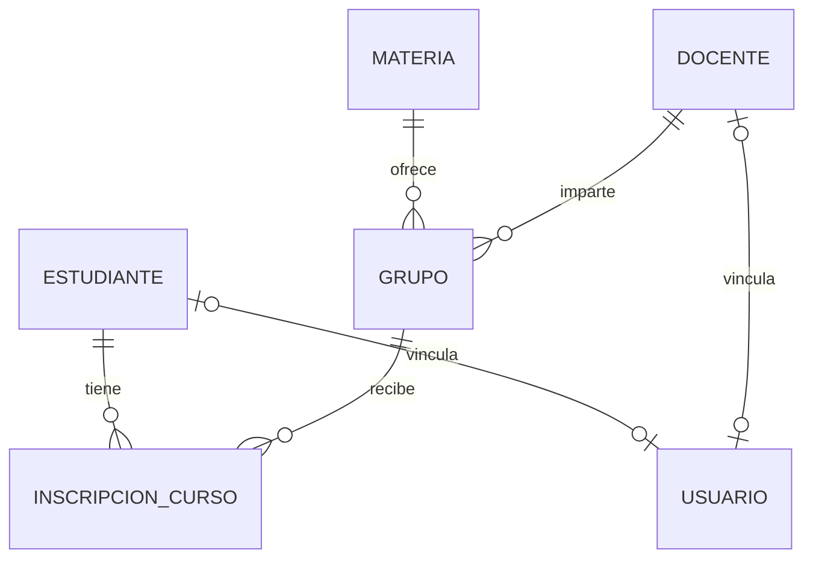

# Sistema Académico UNIAJC

Aplicación de escritorio en Java 17 con interfaz Swing y alternativa de consola. Gestiona estudiantes, docentes, materias, grupos, cuentas, matrículas y calificaciones sobre PostgreSQL, incluido Supabase. Usa arquitectura MVC con servicios y DAO: las dos interfaces comparten las reglas del negocio.

## Requisitos

- JDK 17 o posterior y Maven 3.9.
- PostgreSQL y una cuenta con permisos sobre las tablas del proyecto.
- Escritorio disponible para Swing y para las pruebas de formularios.

No requiere JavaFX. Si la asignatura exige también esa tecnología, esta versión todavía no incluye esa interfaz.

## Instalación de la base de datos

Trabaja primero en una base de desarrollo. Los scripts se ejecutan desde DBeaver, con la conexión y el esquema correctos seleccionados.

**Base nueva:** ejecuta `schema.sql` y después `sql/002_proteger_historial.sql`. El primer archivo crea tablas, índices y funciones; el segundo agrega restricciones de coherencia y protege las relaciones frente a borrados en cascada. No contienen contraseñas de conexión ni borran registros existentes.

**Base existente:** respáldala y ejecuta `sql/002_proteger_historial.sql`. Revisa antes las cuentas sin asociación, correos que solo difieren en mayúsculas y datos antiguos fuera de rango. Las restricciones `NOT VALID` se aplican a nuevas escrituras; no corrigen silenciosamente filas antiguas. Si hay correos duplicados, la creación del índice falla y la transacción revierte: resuelve el conflicto antes de repetir el script. Una vez corregidos los datos, valida las restricciones agregadas desde PostgreSQL.

**Demostración opcional:** únicamente en desarrollo, ejecuta `sql/datos_demostracion.sql`. Agrega estudiantes, docentes, materias, un grupo y matrículas, junto con la cuenta `admin` / `admin123`. Repetirlo no reinicia las claves de cuentas existentes. Cambia esa contraseña desde Control de Usuarios después de entrar. Crea desde allí las cuentas de docentes y estudiantes vinculadas a sus registros. Las credenciales de demostración no describen las cuentas de una base ya existente.

La migración de esta entrega debe aplicarse expresamente a Supabase por quien administra la base. La aplicación no ejecuta migraciones al arrancar.

## Configuración privada

En la raíz del proyecto, copia `config.properties.example` como `config.local.properties` y completa sus tres propiedades:

```properties
URL=jdbc:postgresql://localhost:5432/sistema_academico?connectTimeout=10&socketTimeout=20
USER=postgres
PASSWORD=tu_clave_local
```

Para Supabase usa los parámetros de **Connect → Session pooler** de tu proyecto: host, puerto, usuario completo `postgres.<referencia>` y contraseña de la base. La URL JDBC tiene la forma siguiente:

```text
jdbc:postgresql://HOST:5432/postgres?sslmode=require&connectTimeout=10&socketTimeout=20
```

No uses la contraseña de inicio de sesión de GitHub o Supabase ni las claves de API. El archivo privado está ignorado por Git. `config.properties` queda como aviso sin secretos y `config.properties.example` sirve de plantilla pública.

También puedes establecer `DB_URL`, `DB_USER` y `DB_PASSWORD`. La prioridad es: variables de entorno, archivo privado y finalmente `config.properties`. Ejecuta la aplicación desde la raíz para localizar los archivos. La propiedad Java `sistema.config.dir` permite elegir otro directorio.

Si alguna contraseña estuvo en un commit anterior, retirarla del archivo actual no la elimina del historial: cambia la contraseña de la base desde Supabase y actualiza únicamente la configuración privada. No publiques capturas con secretos.

## Ejecución

Comprueba que `java -version` y `mvn -version` muestran el JDK elegido. Desde la raíz:

```bash
mvn clean test
mvn compile exec:java
```

Para la interfaz de consola:

```bash
mvn compile exec:java -Dexec.args="--consola"
```

En VS Code abre la carpeta completa, permite cargar Maven y ejecuta `com.sistema.Main`. Si cambias el JDK o `pom.xml`, recarga el proyecto Java antes de volver a ejecutar. La clase `com.sistema.config.ConexionBD` también puede ejecutarse para comprobar la conexión sin modificar datos.

En una terminal integrada sin consola protegida, el programa avisa que la contraseña será visible al escribirla. No compartas esa terminal.

## Funciones y permisos

| Perfil | Acceso |
| --- | --- |
| ADMIN | Gestiona estudiantes, docentes, materias, grupos y usuarios; matricula, califica, cancela y consulta registros. |
| DOCENTE | Consulta y califica únicamente matrículas de sus grupos; su boletín muestra las asignaturas que imparte. |
| ESTUDIANTE | Consulta sus propias notas y matrículas y se matricula con su identidad; no modifica calificaciones. |

Una cuenta de estudiante requiere un estudiante existente; una de docente requiere un docente existente. ADMIN no tiene asociación académica. Un registro no se vincula a dos cuentas. Las cuentas antiguas sin vínculo deben corregirse desde Control de Usuarios: no se deduce la identidad por el nombre de usuario ni se asigna el primer estudiante.

La consola ofrece autenticación, consulta, matrícula, calificación, cancelación y administración de las seis entidades. Las comprobaciones de acceso se comparten con Swing; escribir una opción no autorizada también se rechaza.

## Reglas del negocio

- Nombres, correos, aulas y horarios obligatorios con límites de longitud; correo normalizado a minúsculas y sin duplicados por mayúsculas.
- Créditos de materia entre 1 y 10; estudiantes, docentes y materias referenciados deben existir.
- Una matrícula por pareja estudiante/grupo. No permite duplicar una matrícula cancelada ni reactivarla implícitamente.
- Notas finitas entre 0 y 5, redondeadas a un decimal antes de calcular el estado. Desde 3,0: Aprobado; menos de 3,0: Reprobado. Sin nota no se declara aprobación o reprobación.
- Cancelar conserva la fila y la nota histórica; no permite seguir calificándola. El boletín excluye cancelaciones del promedio y de los créditos contabilizados. El promedio mostrado es aritmético entre asignaturas calificadas, sin ponderar por créditos.
- El borrado de estudiantes, docentes, materias y grupos con dependencias se rechaza. Retirar una matrícula significa cancelarla, no eliminar el historial.
- Las contraseñas nuevas o modificadas tienen mínimo ocho caracteres y se guardan con PBKDF2-HMAC-SHA256, sal individual y 600 000 iteraciones. Se conserva lectura de hashes SHA-512 y MD5 antiguos hasta cambiar la contraseña. No se muestran hashes en las tablas de usuarios.
- Las consultas JDBC de Swing se realizan fuera del hilo de la interfaz. Los errores se comunican sin presentarlos como listados vacíos o escrituras exitosas.

## Organización del código

| Carpeta / archivo | Responsabilidad |
| --- | --- |
| `config` | Conexión centralizada, configuración, hashes y traducción de errores. |
| `modelo` | Entidades y DAO con consultas parametrizadas. |
| `servicio` | Validaciones, asociaciones, autorización y boletines. |
| `controlador` | Acciones de Swing y coordinación con servicios. |
| `vista` | Ventanas Swing, ejecución de tareas y consola integrada. |
| `schema.sql`, `sql/` | Estructura, migración y datos opcionales de demostración. |
| `src/test` | Pruebas de servicios, permisos, JDBC e interfaces. |

## Verificación

`mvn test` ejecuta las pruebas con objetos simulados y H2 temporal. No lee credenciales ni escribe en Supabase. Las pruebas de Swing requieren un escritorio. H2 es exclusivamente de pruebas; la aplicación utiliza PostgreSQL.

Hay además una prueba optativa con PostgreSQL real:

```bash
mvn test -Dsistema.test.pg=true
```

Requiere una instancia **descartable y local** en `127.0.0.1:55439`, base `postgres`, usuario `postgres`, con autenticación local configurada para la prueba. No la apuntes a una base compartida. Crea un esquema de nombre aleatorio, prueba estructura, migración y semillas repetidas, autenticación, permisos, matrícula, notas, protección del historial, consola y persistencia; elimina solo ese esquema al terminar. El código rechaza otra dirección.

La entrega se verificó con 37 pruebas satisfactorias, incluida esa integración PostgreSQL. Sin activar dicha opción, esa prueba se omite. La vista previa `com.sistema.soporte.VistaPreviaUsuarios`, ejecutada con el classpath de pruebas, permite revisar el formulario con datos ficticios en memoria.

## Preparación de la entrega

Antes de subir cambios revisa `git diff` y `git status`. No incluyas `config.local.properties`, `.env`, contraseñas, archivos generados ni datos reales. Esta entrega no realiza commit ni push automáticamente.

Para considerar cerrada la instalación en una base compartida, aplica la migración con respaldo previo, cambia las credenciales que estuvieron expuestas, verifica con cuentas de cada perfil y confirma con el docente si se exige JavaFX u otra funcionalidad adicional. Esas verificaciones del entorno no las sustituye la suite local.

## Diagnóstico de conexión

- `Connection refused` con `localhost`: revisa que estés usando el servidor correcto y que PostgreSQL esté iniciado. Una base de Supabase no está en localhost.
- `Invalid JDBC URL`: la URL debe comenzar por `jdbc:postgresql://`; un hostname aislado no basta.
- Error de autenticación: verifica el usuario completo del pooler y la contraseña de la base; no publiques la clave para pedir ayuda.
- Error de red o tiempo agotado: confirma host y puerto con el panel de Supabase y prueba desde DBeaver con los mismos parámetros. El Session pooler permite conexiones desde redes sin IPv6.
- Tabla inexistente: confirma base/esquema y ejecuta la instalación en el orden indicado. Un error de SQL no significa que no haya estudiantes.
- Conflicto al guardar en VS Code: compara con el archivo en disco antes de sobrescribir; después recarga Java si hay diagnósticos desactualizados.

## Recorrido de demostración

1. En una base de desarrollo nueva, instala esquema, migración y ejemplos. Configura el archivo privado y abre Swing.
2. Entra como administrador; crea un estudiante, un docente y una materia. Abre un grupo que los relacione.
3. Crea las cuentas de estudiante y docente con sus asociaciones explícitas; matricula al estudiante en el grupo.
4. Entra con el docente, registra una nota y comprueba que no puede calificar un grupo de otro docente.
5. Entra con el estudiante y consulta su boletín. Comprueba que no hay botones para calificar.
6. Como administrador, cancela la matrícula y verifica que conserva su registro. Intenta borrar una materia con grupos: debe rechazarse.
7. Reinicia la aplicación y comprueba la persistencia. Repite consultas en la consola con las mismas cuentas.

El recorrido interno es Vista → Controlador → Servicio → DAO → PostgreSQL. La consola invoca directamente los servicios. Las relaciones principales son:



Los vínculos de usuario son excluyentes según el rol; ADMIN no requiere ninguno.
